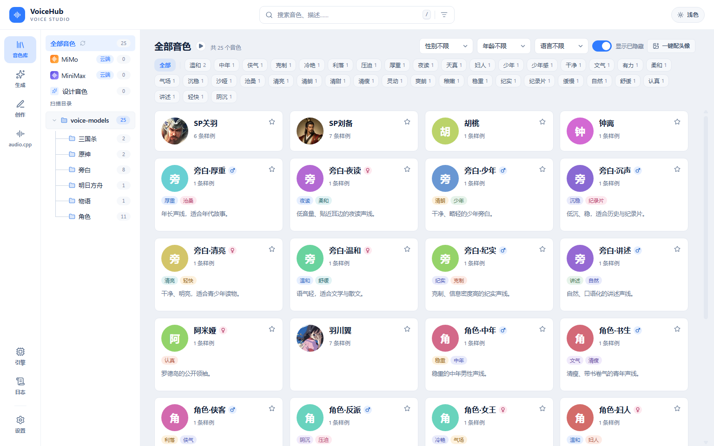
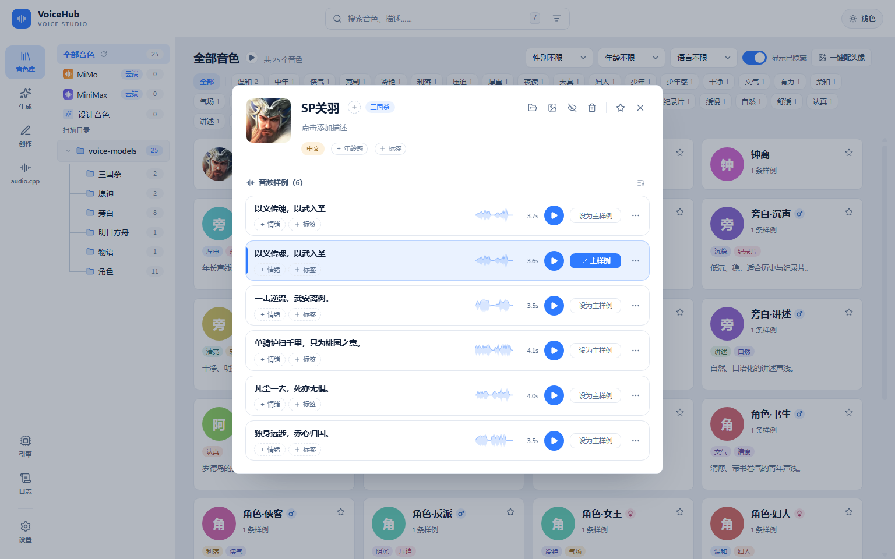
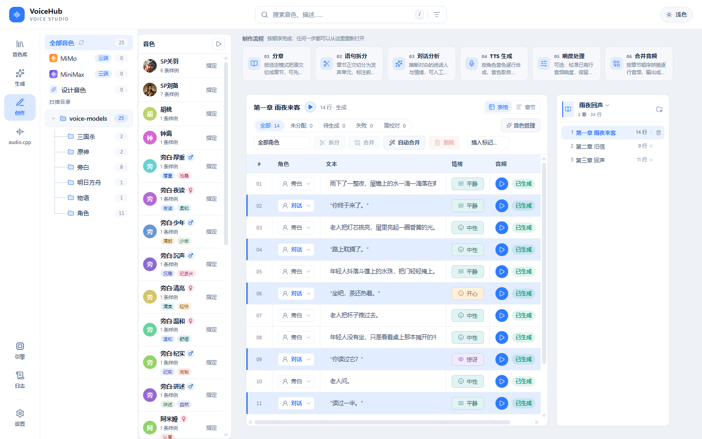
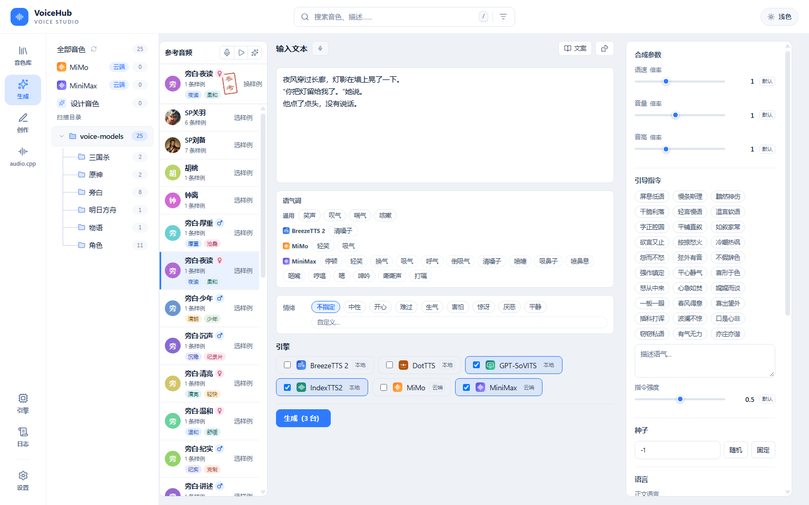

<h1 align="center">VoiceHub</h1>

<p align="center">
  管好一条音色，让它把整本书读完。<br>
  本地音色库 · 逐行合成 · 有声书成品
</p>

<p align="center">
  <a href="LICENSE"></a>
  
  
  
  
  
  
</p>

<p align="center">
  <a href="#快速开始">快速开始</a> ·
  <a href="#功能">功能</a> ·
  <a href="#支持的引擎">引擎</a> ·
  <a href="#开发">开发</a> ·
  <a href="#文档">文档</a>
</p>

---

VoiceHub 是一个本地优先的有声书生产工作台。它以**音色**为中心：在本地维护音色库，把音色分配给
书里的角色，逐行合成、逐章合并，直到拼出整本成品；云端与本机的 TTS 引擎通过插件接入，
换引擎不换音色。

单进程 + SQLite，数据只留在自己的磁盘上，整个 `data/` 目录拷走即可换机器。

<p align="center">
  
</p>
<p align="center"><sub>音色库 —— 分类树、性别 / 年龄感 / 语言筛选、标签与收藏</sub></p>

## 为什么是 VoiceHub

- **一条音色贯穿全程** —— 试听、样例、角色配音、成品都指向同一条音色；换引擎后音色照旧可用。
- **改动可回退** —— 改角色、情绪或参数后旧音频保留，改回原样自动恢复，不重复调用付费引擎。
- **引擎即插件** —— 一台引擎一个目录，配置模型、能力上限、参数映射由插件自述，核心不认识具体厂商。
- **成品不是半成品** —— 合并、静音、码率、BGM、字幕、M4B 一步到底，不用再自己拼 ffmpeg 命令。
- **数据可搬** —— 不依赖外部数据库与云存储；换台机器把 `data/` 拷过去就是同一套库。

## 功能

### 音色库

- **本地音色** —— 扫描根下「直接含音频的文件夹 = 一条音色」，上一级为分类；样例、主样例、封面、
  标签、语言 / 性别 / 年龄感都在这里管理。
- **平台音色** —— MiniMax 拉清单、克隆、生成样例；MiMo 预置音色 + 参考音频复刻 + 描述设计。
  入库后与本地音色同一套筛选、同一种卡片。
- **归属可追** —— 平台音色的样例落在哪个文件夹，就按 `voice.json` 的 `origin` 挂回哪条音色；
  新生成的样例也写回原处，不在库外另起目录。
- **筛选** —— 搜索 + 性别 / 年龄感 / 语言 + 标签，条件会记住；标题旁显示筛后数量。
- **编辑即存** —— 详情里改一格存一格；本地音色删除时文件进回收站，可还原。
- **样例文本** —— 可手填、从 `.txt` 读入，或交给语音识别补上。

<p align="center">
  
</p>
<p align="center"><sub>音色详情 —— 一条音色的多条样例，主样例决定默认参考音频</sub></p>

### 有声书（内置「创作」生产方）

- **导入** —— `.txt` / `.md` / `.markdown` / `.epub` / `.mobi` / `.azw3` / `.azw` / `.prc`；
  `.srt` 建字幕项目。
- **分章** —— 内置预设或自定义正则，先预览再落盘。
- **拆句** —— 台词优先，只切不改字；旁白与对白分开成行。
- **分析** —— 对话模型推断说话人与情绪，支持批次 / 整章、只补未标注、自定义提示词；
  结果可人工修正，同名角色可合并。
- **角色配音** —— 角色到音色的跨章分配。AI 分配是一张可编辑的分配表，逐角色选引擎与方式
  （预置 / 参考音频克隆 / 音色设计），也能只让 AI 匹配某一行；选「音色设计」时可留空，
  AI 会照角色与对白现写那句描述；换音色后旧音频标为「已过期」。
- **逐行合成** —— 并发受引擎上限约束，失败行可单行重试；改回原样自动恢复，不重新花钱合成。
- **成品** —— 合并本章或一键合并全书；行间与章节前后静音、MP3 / WAV / M4A（AAC）、码率可调；
  可另出 BGM 版（响度标准化）与 SRT / LRC 字幕；分章 ZIP 或整本 M4B（章节内嵌）导出。
- **字幕项目** —— 吃 SRT、保留时间码，按真实时间轴拼装，可选「变速贴齐」。
- **进度** —— 目录栏每条章节一盏灯，有未分配 / 待生成 / 失败的行就亮。

<p align="center">
  
</p>
<p align="center"><sub>创作 —— 自上而下走完分章、拆句、分析、生成、后期、合并；行表逐行可改</sub></p>

### 配音（内置「配音」生产方）

- **导入** —— 音频或视频文件直接拖进工作区，按容器探测时长与音轨数；时长读不出即拒收。
- **转录** —— 按停顿切段（−35 dB / 0.35 s 可调）后逐段识别，段落边界就是字幕时间码；
  纯音乐段识别为空即丢弃，不生成空字幕。
- **字幕编辑** —— 下区与时间轴切换显示；行内改文本、换角色、拖时间码，失焦即提交，
  只重跑改动的那一段。`Ctrl+K` 在播放头拆分，`Ctrl+J` 与下一段合并。
- **角色配音** —— 角色是对象（名字 / 配色 / 音色 / 是否保留原声），段落只记角色；
  换音色把该角色名下段落标为过期，不清空已有产物。
- **贴齐与混音** —— 按原时间码补静音、长段加速贴齐（上限可调）、越界顺延并计数；
  人声与原声按电平混合，响度目标可选视频 −16 / 播客 −19 LUFS。
- **导出** —— 视频封装 MP4（画面拷贝、可选字幕轨），音频转 MP3 / M4A / WAV；
  字幕同时写 SRT / VTT / LRC / TXT / ASS，编码与每行字数可设。

### 合成与识别

- **生成页** —— 一个音色同时扇出给多台引擎，按统一参数规范渲染表单；结果落盘归档，
  失败时显示那台引擎的原话。
- **语音识别** —— Qwen3-ASR / SenseVoice-Small 插件，连接本机或局域网中的识别服务；
  用于样例补文本、正文语音输入、参考音频录音转写。可开启「连接时自动识别」，
  把库里缺逐字稿的样例逐条补齐。
- **接口** —— `/api/v1` 对外提供音色清单、参考音频、合成与引擎自描述，可作为独立中转站使用。

<p align="center">
  
</p>
<p align="center"><sub>生成 —— 一条音色同时扇出给多台引擎，参数表单由各引擎自己声明</sub></p>

## 支持的引擎

| 引擎 | 形态 | 音色来源 |
|---|---|---|
| MiniMax | 云端 | 平台清单 + 克隆（国内站 / 国际站密钥不通用） |
| Fish Audio | 云端 | 平台清单（含公开音色库）+ 克隆；情绪与演法写成正文标签 |
| Kitta Audio | 云端 | 平台清单 + 克隆；供应商无关的 v3 协议，情绪并进引导指令 |
| MiMo | 云端 | 预置音色；参考音频复刻；描述设计（每次合成按描述重新设计） |
| GPT-SoVITS | 本机 | 音色库供给（参考音频 + 参考文本） |
| BreezeTTS 2 | 本机 | 音色库供给 + 一句话描述音色 |
| IndexTTS2 | 本机 | 音色库供给，带情感控制 |
| dots.tts | 本机 | 音色库供给 |
| VoxCPM2 | 本机 | 参考音频克隆 + 一句话描述音色 |
| CosyVoice3 | 本机 | 参考音频克隆 + 跨语种 + 指令控制 |
| Qwen3-TTS | 本机 | 参考音频克隆（需逐字稿），10 种语言 |
| OmniVoice | 本机 | 参考音频克隆（需逐字稿），600+ 语言 |
| Qwen3-ASR | 本机 / 局域网 | 语音识别（连接外部服务） |
| SenseVoice-Small | 本机 / 局域网 | 语音识别（连接 audio.cpp 实例） |

云端引擎填 API Key，本机引擎填推理服务地址；字段由插件自己声明，前端不写死。

## 快速开始

### 运行

| 方式 | 命令 | 说明 |
|---|---|---|
| 源码 · Windows | `start.bat` | 自动 `uv sync`，前端产物缺失或过期时自动构建 |
| 源码 · macOS / Linux / Git Bash | `./start.sh` | 同上；未在 CI 验证 |
| 托盘常驻 | `start-tray.vbs` | 无窗口，可设开机自启 |
| 便携包 | `uv sync --group package` → `uv run --group package python packaging/build.py` | 产出 `dist/` 与 zip |
| 发版 | `git tag v0.1.0 && git push --tags` | `release.yml` 构建便携包、签名（凭据存在时）、上传 Release |

发布物只有 Windows 便携包：macOS / Linux 可以从源码跑，但这条路径未在 CI 验证
（测试与打包都只在 Windows 上跑），也没有系统托盘。遇到平台相关问题欢迎 PR。

需要 [uv](https://docs.astral.sh/uv/getting-started/installation/) 与 Node.js（构建前端用）。

### 首次使用

1. 打开 <http://127.0.0.1:17865>。
2. 左下角「设置 → 目录」加入音色库根目录。
3. 左栏「引擎」里选一台，填 API Key 或本机推理地址。
4. 生成页挑一条音色试听；「创作」里导入书稿即可开始。

> 本机引擎（GPT-SoVITS / BreezeTTS 2 / IndexTTS2 / dots.tts / VoxCPM2 / CosyVoice3 / Qwen3-TTS / OmniVoice）需自行启动推理服务：
> VoiceHub 只写请求侧，不下载权重、不部署服务。例外是侧栏的「audio.cpp」运行时插件，
> 它可在用户触发下下载、启动、卸载自管的二进制与模型，文件只落在自己的数据目录。

### 运行参数

- 端口 / 监听地址：`--port` / `--host`、`VOICEHUB_PORT` / `VOICEHUB_HOST`，或 `config.json`。
- 局域网访问：`--host 0.0.0.0`，建议同时设 `VOICEHUB_TOKEN` 或 `config.json` 的 `access_token`。
- 数据目录：默认 `./data`，可用 `VOICEHUB_DATA_DIR` 指到别处。
- 单实例：同一个数据目录只允许一个服务进程（`data/service.lock`）。第二个实例会直接退出——
  两份进程同时推进同一批任务，会把同一段音频写进同一个文件。

## 开发

```bash
uv sync
uv run python -m uvicorn app.main:app --reload --port 17865   # 后端
cd web && npm install && npm run dev                          # 前端（代理 /api）
cd web && npm run typecheck && npm run build                  # 构建产物交给后端托管

uv run pytest                                                  # 测试
uv run ruff check app/ tests/                                  # 静态检查
uv run python scripts/smoke.py --base http://127.0.0.1:17865    # 接口冒烟
node scripts/shot.mjs http://127.0.0.1:17865/ ./.shots/vh-shots   # 界面自检 + 截图
```

### 项目结构

```
app/                 FastAPI 后端（同时托管前端构建产物）
  domain/            模型与纯规则（零 IO）
  usecase/           用例：音色库、引擎、合成中转
  infra/             文件系统 / SQLite / 配置 / 时长与 ffmpeg
  engines/           TTS 与 ASR 插件（builtin/<key>/ 一台引擎一个目录）
  llm/               对话模型通道（内置 DeepSeek）
  producers/         生产方插件（audiobook：分章 → 拆句 → 分析 → 生成 → 合并；
                     dubbing：抽音轨 → 转录 → 配音 → 贴齐 → 导出）
  api/               HTTP 层
web/                 Vue 3 + Vite 前端
data/                config.json、hub.db、项目库、缓存、录音
```

- **单进程** —— 一个 FastAPI 服务同时提供 `/api/v1` 与前端静态页，启动即用。
- **SQLite** —— 音色索引一本库，每个生产方自己的项目库一本（WAL 模式）。
- **插件化** —— 引擎、识别、对话模型、生产方四类插件都是「一个目录 = 一个插件」，
  自声明配置模型、能力、参数映射与路由。
- **ffmpeg** —— 时长探测、逐行拼接、BGM 混音、变速贴齐与字幕时间轴。

## 使用边界

音色克隆与复刻只用于自有声音或已获得授权的声音；接入平台时遵守其条款，产物与用途由使用者负责。
仓库内的引擎图标除 DeepSeek 外均为自绘，DeepSeek 图标是其官方标识，仅用于标识对应服务。

## 贡献

提交前跑一遍 `uv run ruff check app/ tests/` 与 `uv run pytest`。

## 相关项目

下列项目是本项目对接的引擎与运行时，通过 HTTP 调用它们的服务。除随包附带的 FFmpeg 外，
本仓库不包含也不分发它们的代码与模型权重；链接供部署时参考，各自遵循原许可：

- [GPT-SoVITS](https://github.com/RVC-Boss/GPT-SoVITS) —— 本机零样本音色克隆
- [IndexTTS](https://github.com/index-tts/index-tts) —— 带情感控制的中文 TTS
- [dots.tts](https://github.com/studio-dots-ai/dots.tts) —— 本机 TTS
- [CosyVoice](https://github.com/FunAudioLLM/CosyVoice) —— 零样本克隆、跨语种与指令控制
- [OmniVoice](https://github.com/k2-fsa/OmniVoice) —— 600+ 语言的多语种零样本 TTS
- [Breeze TTS 2](https://huggingface.co/BreezeBlue/Breeze-TTS-2) —— 中英文音色设计与克隆
- [audio.cpp](https://github.com/0xShug0/audio.cpp) —— 本机推理运行时
- [Qwen3-ASR](https://github.com/QwenLM/Qwen3-ASR) —— 语音识别
- [SenseVoice](https://github.com/FunAudioLLM/SenseVoice) —— 语音识别
- [MiMo-Audio](https://github.com/XiaomiMiMo/MiMo-Audio) —— 小米音频模型
- [FFmpeg](https://ffmpeg.org) —— 时长探测、拼接、混音与转码
- [uv](https://docs.astral.sh/uv) —— Python 环境与依赖

## 许可证

[MIT](LICENSE) © 2026 kkvrry

可自由使用、修改、分发，包括商用，保留版权与许可声明即可。项目自身的运行依赖均为宽松许可
（MIT / BSD / Apache-2.0），不引入 copyleft 义务。

注意：本许可证只覆盖本仓库的代码。通过插件接入的 TTS 引擎、模型权重与云服务（如 GPT-SoVITS、
IndexTTS2、MiniMax、MiMo）各有各的许可与商用条款，需自行确认 —— 本项目不下载也不分发这些权重。
